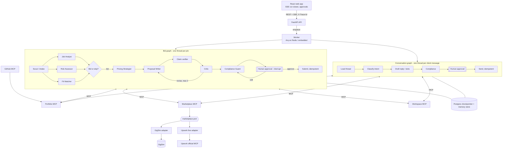

# Architecture

## Why each agent exists

| Agent | Why it is a separate node | Model |
|---|---|---|
| Scout | Scheduled, cheap, idempotent intake: saved searches, dedup by content hash, queueing. No LLM. | none |
| Job Analyst | Turns untrusted text into a typed `JobSpec`; isolated from tools so an injected post cannot trigger a tool call. | small (`gpt-oss-20b`) |
| Risk Assessor | Rules first (scam, free-work, off-platform, injection patterns) plus client history; small LLM only for ambiguous cases. Runs in parallel with the analyst and matcher. | small |
| Fit Matcher | Maps every requirement to portfolio evidence via `search_evidence`; produces the evidence matrix the UI shows. | none (retrieval) |
| Pricing Strategist | Deterministic quote from Kaggle-derived market percentiles, the client budget and the user's floor; decides whether the Connects cost is worth it. | none |
| Proposal Writer | The only creative step; gets evidence ids and must cite them. | strongest (`gpt-oss-120b`) |
| Claim verifier | Splits the draft into claims and grounds each one; removes unsupported claims before the critic (B3/R5). | small + embeddings |
| Critic | Grounding, personalisation and length checks plus an LLM rubric; sends the draft back at most twice. | strongest |
| Compliance Guard | Pure policy-pack enforcement from `rules.yaml`, so a policy change is a config change. | none |
| Client Liaison | Intent classification, reply drafts and interview slots; same approval gate. | strong |

## State, trace and memory are kept apart
* **State** (`agent/state.py`): what this job or conversation needs now. Parallel branches write into
  `analyses` through a merge reducer.
* **Execution trace**: `trace` uses an append-only reducer of every tool call, observation and decision.
  It is PII-masked, persisted with each checkpoint, and shown in the run viewer.
* **Long-term memory** (`agent/memory`): a LangGraph store holding style memory and outcome memory. Entries
  are written only by `promotion_rules.py`; raw tool output never enters memory.

## Durability and failure handling
* Postgres checkpointer (SQLite locally). A pending approval survives an API restart, and the approval
  screen is rebuilt from the interrupt.
* `submit` is a separate node, and its idempotency key is derived from `(thread, draft)`. A crash after
  approval re-executes only `submit`, and the marketplace returns the stored result instead of submitting twice.
* Per-node `RetryPolicy` and timeouts. A fallback model is used for cheap nodes. Marketplace outages put a
  job in `dead_letter` (retried by the worker), and a submit queued during an outage keeps `status=approved`
  and is retried with the same key.
* Step and token budgets per thread: exceeding either moves the thread to `needs_attention`, shown in the UI.

## The marketplace port (R1)
The graph only knows `agent/marketplace_port.py`. The port only talks to the Marketplace MCP server, and
the server chooses the adapter from the user's connected account (`gigsim` or `upwork_live`). Switching to
live mode changes the account mapping and config, not graph code.
