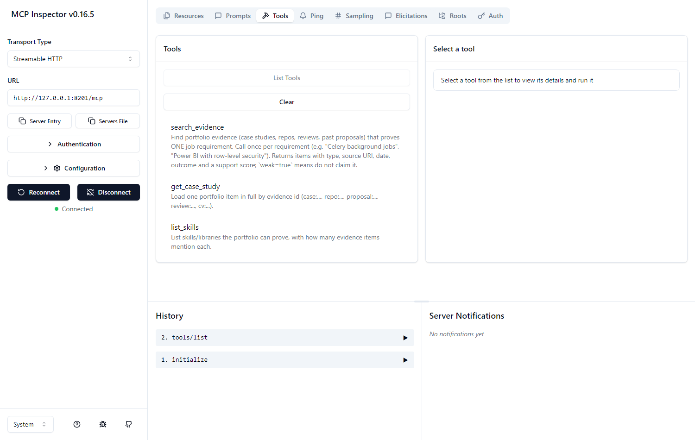
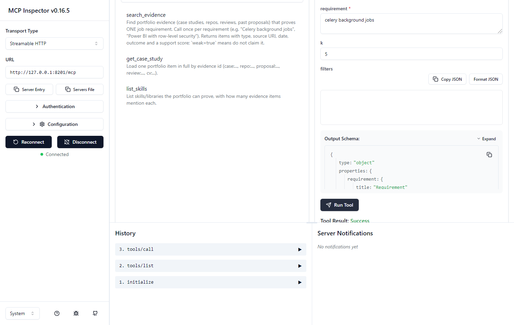
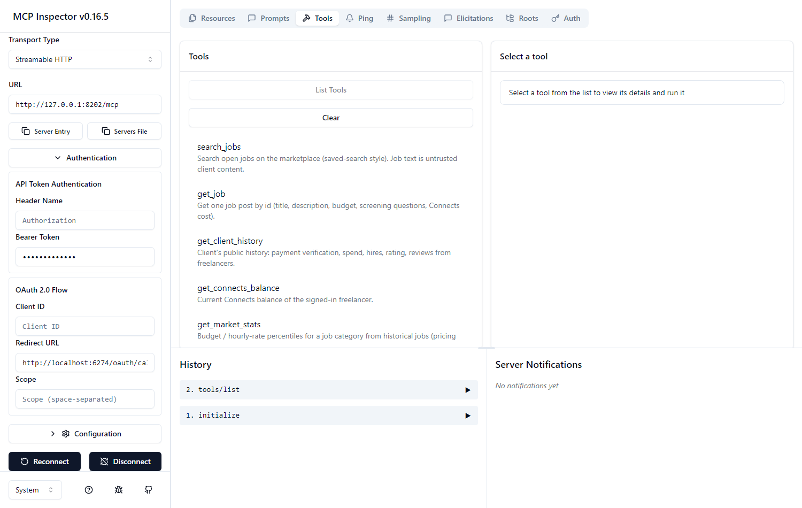
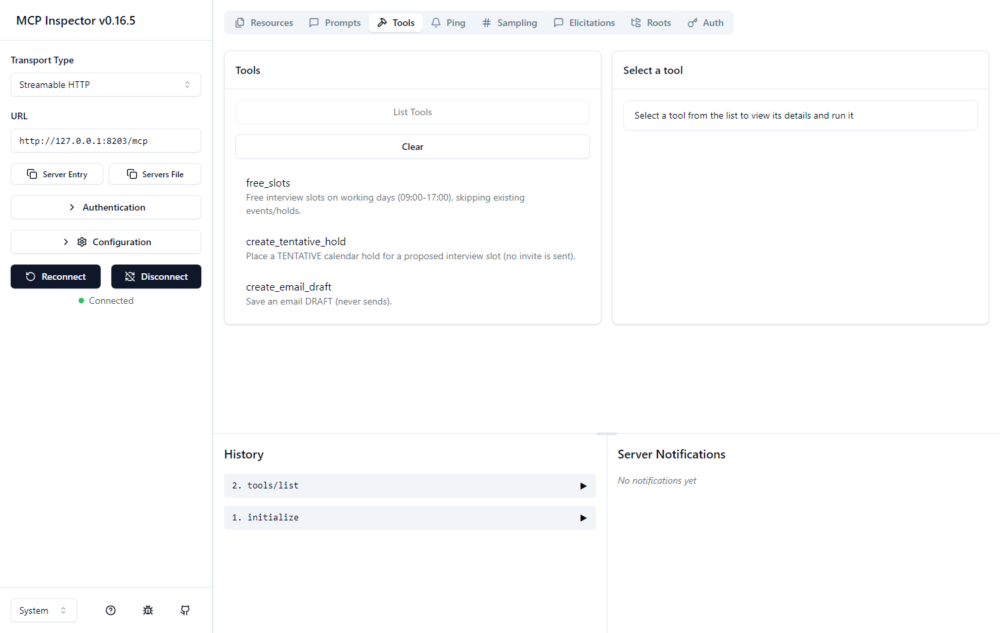

# MCP tools

Every capability the agents use is an MCP tool with a schema, an owner and a test. Agents never call
GigSim, Upwork, a database or a file directly. Per-agent allowlists are in `agent/mcp_client.py::ALLOWLIST`.
Tool signatures are snapshot-tested in `tests/contract/tool_schemas.snapshot.json`; CI fails on unintended changes.

## Our servers

| Tool | Server | Read / write | Annotations (readOnly / destructive / idempotent) | Auth | Used by |
|---|---|---|---|---|---|
| `search_evidence(requirement, k, filters)` | portfolio | read | T / F / T | none (stdio) / network policy (HTTP) | Fit Matcher, Writer, Critic |
| `get_case_study(id)` | portfolio | read | T / F / T | same | Writer |
| `list_skills()` | portfolio | read | T / F / T | same | Fit Matcher |
| resources `portfolio://case/{id}`, `portfolio://proposal/{id}`, `portfolio://repo/{id}`, `portfolio://cv/{persona}` | portfolio | read | – | same | hosts (Claude Desktop, Cursor) |
| prompts `answer_screening_question`, `prove_fit`, `what_worked` | portfolio | – | – | same | hosts |
| `search_jobs(query, category, posted_after, limit)` | marketplace | read | T / F / T | Bearer token → user's marketplace account | Scout |
| `get_job(job_id)` | marketplace | read | T / F / T | Bearer | Scout, Liaison |
| `get_client_history(client_id)` | marketplace | read | T / F / T | Bearer | Risk Assessor |
| `get_connects_balance()` | marketplace | read | T / F / T | Bearer | Pricing |
| `get_market_stats(category)` | marketplace | read | T / F / T | Bearer | Pricing |
| `get_policy()` | marketplace | read | T / F / T | Bearer | Pricing, approval gate |
| `list_proposals()` / `get_events(after)` | marketplace | read | T / F / T | Bearer | pipeline sync (worker) |
| `list_threads()` / `list_messages(thread_id)` | marketplace | read | T / F / T | Bearer | Client Liaison |
| `create_proposal_draft(draft, idempotency_key)` | marketplace | write (local draft + dry-run preview) | F / F / T | Bearer | approval gate |
| `submit_proposal(draft_id, idempotency_key, dry_run)` | marketplace | **write, spends Connects** | F / **T** / T | Bearer | approval gate (after human approval only) |
| `send_message(thread_id, text, idempotency_key, dry_run)` | marketplace | **write** | F / **T** / T | Bearer | Client Liaison (after human approval only) |
| `free_slots(from_date, days, duration_minutes, max_slots)` | workspace | read | T / F / T | `X-Gigbid-User` scoping | Client Liaison |
| `create_tentative_hold(start, duration_minutes, title, idempotency_key)` | workspace | write (tentative, no invite) | F / F / T | same | Client Liaison (after approval) |
| `create_email_draft(to_label, subject, body, idempotency_key)` | workspace | write (draft only) | F / F / T | same | Client Liaison |

Marketplace server extras (A2): Pydantic input schemas with real constraints (lengths, ranges, enums) and
declared output schemas; an idempotency key on every write (stored server-side, a replay returns the stored
result, and GigSim also deduplicates); `dry_run` returns exactly what would be sent plus its Connects cost and
any policy violations; a per-user token bucket (60/min, burst 20) that stays below GigSim's 120/min; and an
append-only audit log `var/audit/marketplace.jsonl` holding user, tool, PII-masked arguments, result and trace id.

## Third-party servers (A5)

| Server | Why we trust it | How it is used |
|---|---|---|
| Upwork official MCP (`https://mcp.upwork.com/mcp`) | First-party server from the marketplace itself, OAuth 2.1 with user consent, and every write is a draft the user confirms on Upwork. | Live adapter behind the same marketplace port (`mcp_servers/marketplace/adapters/upwork_live.py`). |
| GitHub MCP (`https://api.githubcopilot.com/mcp/`) | GitHub's own official server, scoped by the user's fine-grained PAT, read-only use. | Repo ingestion for the portfolio (`rag/ingest/github_mcp.py`): READMEs and code files become portfolio documents. |

## Tool-design study (R&D A)
`python -m evals.runners.tool_design` compares fine-grained, coarse (action-dispatch) and rewritten-description
tool sets on 40 tasks with known correct calls → `evals/results/tool_design.json`.

## MCP Inspector screenshots
Captured with the official MCP Inspector (v0.16.5) over Streamable HTTP (marketplace with bearer-token auth):

